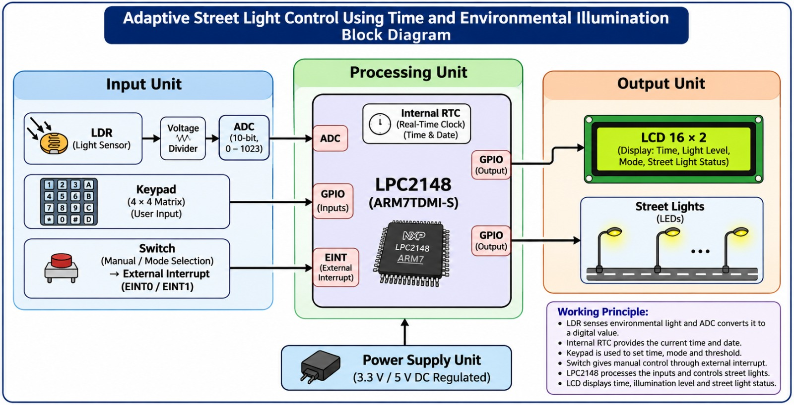
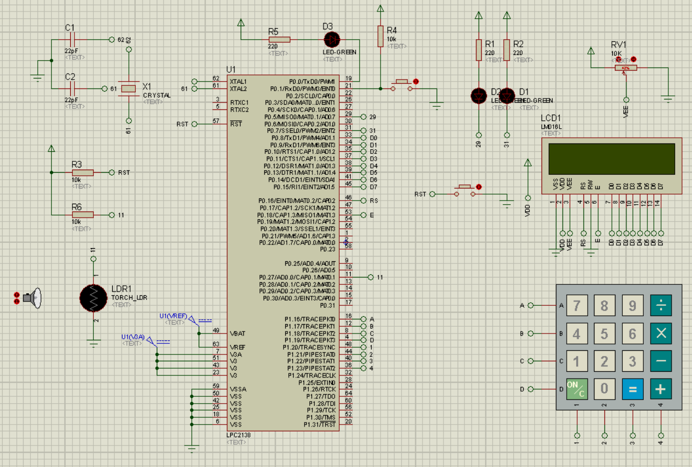
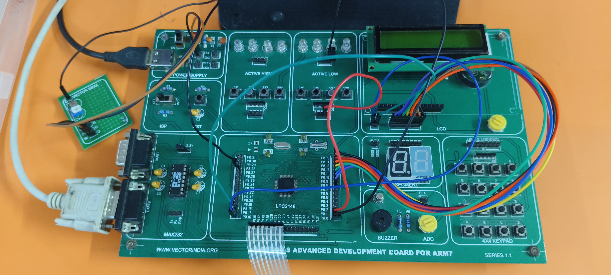

# Adaptive Street Light Control Using Time and Environmental Illumination

## 1. Project Overview

The **Adaptive Street Light Control System** is an embedded systems project developed using the LPC2148 ARM7 microcontroller.

The system uses an LDR (Light Dependent Resistor) sensor to detect surrounding light intensity and the internal RTC (Real-Time Clock) of the LPC2148 to obtain time information.

Based on environmental illumination and time conditions, the system controls the street light LEDs. An LCD is used to display relevant information, and a matrix keypad is provided for user interaction.

The main objective is to improve energy efficiency by controlling street lights according to lighting conditions and time.

## 2. Objectives

- Automatically control street lights based on environmental illumination.
- Use the LPC2148 internal RTC for time-based operation.
- Read LDR sensor values through the ADC.
- Display system information on an LCD.
- Provide user interaction through a matrix keypad.
- Reduce unnecessary power consumption.

## 3. Hardware Requirements

- LPC2148 ARM7 Development Board
- LDR Sensor
- ADC interface
- 16x2 LCD Display
- Matrix Keypad
- LED Street Light Indicators
- Required resistors and connecting wires
- Suitable power supply

## 4. Software Requirements

- Keil µVision IDE
- Embedded C
- Proteus Design Suite (for circuit simulation, if used)

## 5. System Block Diagram



## 6. Circuit Diagram



## 7. Working Principle

1. The LDR sensor detects the surrounding light intensity.
2. The sensor output is processed through the ADC of the LPC2148.
3. The internal RTC provides the current time and date.
4. The microcontroller processes the illumination and time information.
5. The street light LEDs are controlled according to the programmed conditions.
6. The LCD displays relevant system information.
7. The keypad allows the user to interact with the system and configure time-related values.

## 8. Module Description

| Module | Description |
|---|---|
| LPC2148 ARM7 | Main controller of the project |
| LDR + ADC | Detects environmental illumination |
| Internal RTC | Maintains time and date |
| LCD | Displays system information |
| Matrix Keypad | Provides user input |
| LED Control | Controls street light LEDs |

**Note:** The RTC used in this project is the internal RTC peripheral of the LPC2148. No external RTC module is required.

## 9. Project Folder Structure

```text
Adaptive_street_light_control/
│
├── Block_diagram/
│   └── block_diagram.jpeg
│
├── Circuit_diagrams/
│   └── Circuit_digram.png
│
├── header_files/
│   ├── defines.h
│   ├── delay.h
│   ├── interrupt.h
│   ├── kpm.h
│   ├── kpm_defines.h
│   ├── lcd.h
│   ├── lcd_defines.h
│   ├── rtc.h
│   └── types.h
│
├── Project_images/
│   └── IMG_20261123_163124.jpg
│
├── source_code/
│   ├── delay.c
│   ├── interrupt_1.c
│   ├── kpm_1.c
│   ├── lcd_1.c
│   ├── main.c
│   └── rtc_1.c
│
└── README.md
```

## 10. Testing

The following project modules were implemented and tested:

- LPC2148 microcontroller operation
- LDR sensor and ADC interface
- LCD display
- Internal RTC
- Matrix keypad
- LED street light control

## 11. Project Image



## 12. Advantages

- Automatic street light control
- Improved energy efficiency
- Time-based and illumination-based operation
- Reduced manual intervention
- Simple embedded system implementation

## 13. Future Enhancements

- Wireless monitoring and control
- IoT-based street light monitoring
- Fault detection and reporting
- Energy consumption monitoring
- Integration with a larger street lighting network

## 14. Conclusion

The Adaptive Street Light Control System demonstrates the use of the LPC2148 ARM7 microcontroller for intelligent street light management.

By combining LDR-based illumination sensing, ADC conversion, the internal RTC, LCD, keypad, and LED control, the project provides an embedded solution for automatic street light operation.

## 15. Repository

**GitHub Repository:**  
https://github.com/jagadesh44/Adaptive_Street_Light_Control

